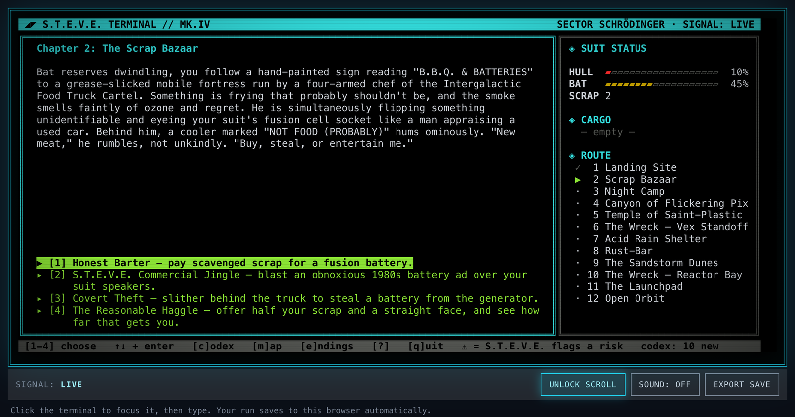
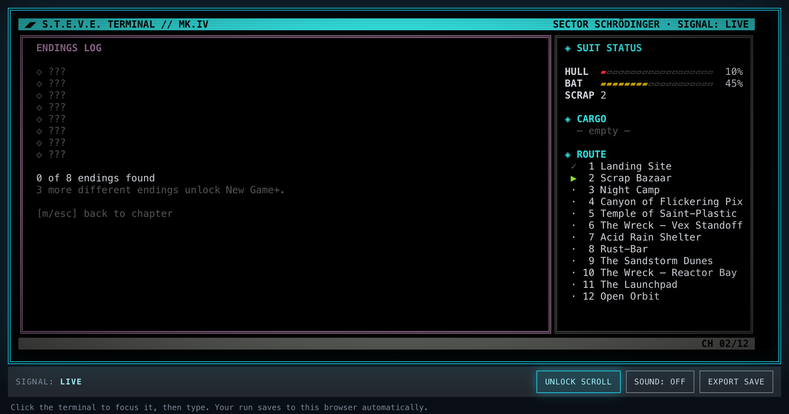

# SIGNAL LOSS: SECTOR SCHRÖDINGER

[](https://github.com/aeon022)

A retro-futuristic sci-fi text adventure for the terminal. You crash-land on Gryps-4 — a cosmic
dumping ground — with a sarcastic, anxious, perpetually-low-on-battery ship AI and a spine of twelve
chapters to make worse. Failures cost you more than time (a botched theft puts you to work at the
grill, a bad bluff lands you in a pirate's brig), the road forks halfway through, factions
remember what you did, items open shortcuts or save your life once, and some choices only appear
because of an earlier one. Eight endings, one of them hidden behind New Game+.



Built with Go and [Bubble Tea](https://github.com/charmbracelet/bubbletea)/[Lipgloss](https://github.com/charmbracelet/lipgloss).
The screen fills your terminal (60×22 and up) and resizes with it. Also runs in a browser — the
exact same engine, compiled to WebAssembly, no reimplementation. See `roadmap.md` for how that
works and everything else that went into this.

## Play

**In your browser: https://aeon022.github.io/signal_loss/** — no install, same Go engine
compiled to WebAssembly.

Or install it (no Go needed — this downloads the ready-made binary for your system into `~/.local/bin`):

```sh
curl -fsSL https://raw.githubusercontent.com/aeon022/signal_loss/main/install.sh | sh     # Linux, macOS
irm https://raw.githubusercontent.com/aeon022/signal_loss/main/install.ps1 | iex          # Windows (PowerShell)
signal_loss
```

With Go installed, `go install github.com/aeon022/signal_loss/cmd/signal_loss@latest` works too (the
binary lands in `~/go/bin`; the story files are built in). Or build it yourself:

```sh
git clone https://github.com/aeon022/signal_loss.git && cd signal_loss
go build -o signal_loss ./cmd/signal_loss && ./signal_loss
```

### Flags

- `-fast` — skip the typewriter effect and compress time-locks to a couple of seconds
- `-realtime` — make time-locks real minutes/hours instead of compressed seconds; the wait is
  saved to disk and enforced on next launch too, `-fast` can't skip it
- `-lang en|de` — game language, UI chrome and story content (asked at the start of a new run if omitted; a run keeps its language); the browser build
  has the same choice as a launch-screen toggle
- `-save PATH` — save file location (default `save.json`)
- `-stats PATH` — stats file (default `stats.json`): runs, deaths, endings found; three different endings unlock a hidden chapter (New Game+)
- `-story PATH` — story data file (default: the story built into the binary)

### Controls

`1`–`9` choose · `↑↓` + `Enter` navigate · `c` codex · `m` map · `e` endings log · `?` help · `PgUp`/`PgDn` scroll long text · `q` quit

A ⚠ in front of a choice means S.T.E.V.E. flags it as deadly — once he has a route, or you found the manual.



## Development

```sh
go build ./...
go vet ./...
```

`cmd/wasm/` is a separate Go module (its own `go.mod`) — it pins a small, audited fork of Bubble
Tea that adds the couple of platform hooks (`tty_js.go`, `signals_js.go`) needed to compile for
`GOOS=js`, which isn't supported upstream. The native CLI here is unaffected; it uses real,
unmodified Bubble Tea.

## Support

If you enjoyed getting stranded on Gryps-4: [support the project on Polar](https://buy.polar.sh/polar_cl_CbYo27mWKgPdiEv3IJS680uCrzqDus7LWzd131V74y0).

## License

MIT — see `LICENSE`.

## 🏢 About abteilung83

Engineered and maintained by **abteilung83** — developer tools, terminal UIs, and the occasional
sci-fi text adventure. [github.com/aeon022](https://github.com/aeon022)
